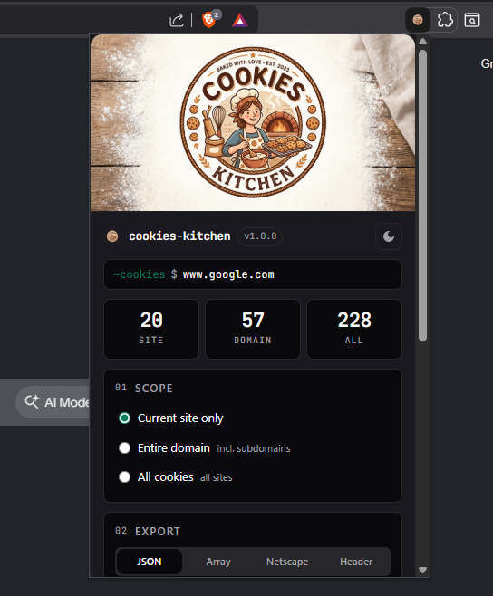

<p align="center">
  
</p>

# Cookies Kitchen

Cross-browser extension (Manifest V3) to **export** and **import** browser cookies as JSON. Backup sessions, move cookies between profiles, or share a test session with a teammate.

## Screenshot

<p align="center">
  
</p>

## Features

- **Live counts** for current site, whole domain, and all cookie stores — refreshed after every import/delete
- **Scope picker**: current URL, entire domain (incl. subdomains), or every cookie store (default + incognito + containers)
- **Export** to a JSON file (Save As dialog) or **copy** to clipboard
- **Import** from a JSON file, with optional overwrite of existing cookies
- **Delete** cookies in the selected scope
- Dark / light theme following `prefers-color-scheme`, with manual override
- Styled with **Tailwind CSS v4** using pphat.me's design tokens (emerald primary, HSL-based theming)
- ESM modules, MV3, no runtime dependencies

## Supported browsers

| Browser | Manifest | Notes |
|---|---|---|
| **Chrome / Chromium** | `manifest.json` | MV3 service worker |
| **Edge** | `manifest.json` | Same as Chrome |
| **Brave** | `manifest.json` | Shields may partition cookies — set Shields Down per-site if counts are zero |
| **Opera / Opera GX** | `manifest.json` | Chromium-based |
| **Vivaldi** | `manifest.json` | Chromium-based |
| **Arc** | `manifest.json` | Chromium-based |
| **Samsung Internet** | `manifest.json` | Android; sideload via `chrome://extensions` in desktop mode |
| **Kiwi Browser** | `manifest.json` | Android Chromium |
| **Firefox / Nightly / DE** | `manifest.firefox.json` | Uses `background.scripts` (Nightly disables MV3 SW by default). **Must grant host permission per site** — see below. |
| **Safari (macOS / iOS)** | `manifest.json` | Requires Xcode + `safari-web-extension-converter` on macOS |

## Download a release

Grab a prebuilt zip from the [Releases page](../../releases) — one per browser family:

- `cookies-kitchen-chromium-vX.Y.Z.zip` — Chrome, Edge, Brave, Opera, Vivaldi, Arc
- `cookies-kitchen-firefox-vX.Y.Z.zip` — Firefox regular / Nightly / Developer Edition
- `cookies-kitchen-safari-vX.Y.Z.zip` — source folder for `xcrun safari-web-extension-converter`
- `SHA256SUMS.txt` — verify integrity with `sha256sum -c SHA256SUMS.txt`

Unzip and follow the per-browser install steps below. No `npm install` required for consumers — the build is already inside the zip.

## Continuous integration

Every PR and every push to `main` runs [`.github/workflows/ci.yml`](.github/workflows/ci.yml):

1. Installs deps against Node 18 and Node 20
2. `npm run validate` — checks both manifests parse, have MV3 shape, list `cookies`+`host_permissions`, and every referenced file exists
3. `npm run build` — Tailwind CSS + all three targets
4. `web-ext lint` on the Firefox build
5. Packages each `dist/` into a zip (uploaded as a PR artifact, 7-day retention)
6. Reports folder / zip sizes to the run summary

Run the same checks locally:

```powershell
npm run validate
npm run build
```

## Cutting a release (maintainer)

```powershell
# Bump manifest.json + manifest.firefox.json version, commit, then:
git tag v1.0.1
git push origin v1.0.1
```

The [`Release` workflow](.github/workflows/release.yml) fires on tags matching `v*`, builds Chromium/Firefox/Safari artifacts, syncs the manifest version to the tag, computes SHA-256, and publishes them as GitHub Release assets with auto-generated release notes. It can also be triggered manually from the Actions tab.

## Prerequisites

```
node --version   # 18+ (for the build scripts)
npm --version    # any recent
```

## Setup

```powershell
npm install
```

That pulls Tailwind CSS v4 + CLI.

## Build

```powershell
# Build all targets (Chromium, Firefox, Safari-ready) into dist/
npm run build

# Or one at a time
npm run build:chromium
npm run build:firefox
npm run build:safari

# CSS only, or watch mode while iterating
npm run build:css
npm run watch:css
```

Each target ends up in `dist/<target>/` and is loadable directly by the corresponding browser.

## Install per browser

### Chrome / Edge / Brave / Opera / Vivaldi / Arc

1. `npm run build:chromium`
2. Open `chrome://extensions` (or `edge://…`, `brave://…`, `opera://…`).
3. Enable **Developer mode**.
4. **Load unpacked** → select `dist/chromium/`.

For active development you can also point Load unpacked at the project root — the extension will work directly, no build needed for Chromium.

### Firefox / Firefox Nightly / Firefox Developer Edition

Firefox needs a manifest with `background.scripts` because MV3 service workers are gated behind a flag in Nightly.

1. `npm run build:firefox`
2. Open `about:debugging#/runtime/this-firefox`
3. **Load Temporary Add-on…** → select `dist/firefox/manifest.json`
4. **Grant host permission** (Firefox MV3 is opt-in):
   click the extension puzzle icon → **Cookies Kitchen** → **⋯** → **Manage Extension** → **Permissions** → toggle **Access your data for all websites** ON.
   Without this, `chrome.cookies.getAll()` returns an empty array silently.
5. Temporary add-ons unload when Firefox restarts — reload after each restart. For permanent install, package + sign at [addons.mozilla.org](https://addons.mozilla.org/developers/).

### Safari (macOS or iOS) — requires macOS + Xcode

Safari runs web extensions inside a native app shell.

```bash
npm run build:safari
xcrun safari-web-extension-converter dist/safari \
  --project-location build/safari \
  --app-name "Cookies Kitchen" \
  --bundle-identifier me.pphat.cookies-kitchen
```

Then open the generated `.xcodeproj` in Xcode and run. To ship, sign with a Developer ID; for iOS, target iOS Simulator or a device via TestFlight.

Enable it in Safari → Settings → Extensions → Cookies Kitchen. Per-site permission grant is required, similar to Firefox.

## JSON format

Exported files look like:

```json
{
  "exportedAt": "2026-07-27T12:00:00.000Z",
  "source": "https://example.com/",
  "scope": "current",
  "count": 3,
  "cookies": [
    {
      "name": "session_id",
      "value": "abc123",
      "domain": ".example.com",
      "path": "/",
      "secure": true,
      "httpOnly": true,
      "sameSite": "lax",
      "expirationDate": 1785283200
    }
  ]
}
```

Import accepts either the wrapped object above **or** a bare array of cookies.

## Security notice

Cookies often contain session tokens. Treat exported files like passwords:

- Do not share exported cookies publicly.
- Store backups in an encrypted location.
- Delete files you no longer need.

## Project layout

```
cookies-kitchen/
├── manifest.json            Chromium manifest (Chrome/Edge/Brave/Opera/Safari)
├── manifest.firefox.json    Firefox manifest (background.scripts variant)
├── background.js            Service worker / event page (ESM)
├── popup.html               UI shell — Tailwind utility classes
├── popup.css                Tailwind v4 build output (regenerated by npm run build:css)
├── src/
│   ├── styles/input.css     Tailwind entry — @theme tokens matching pphat.me
│   ├── popup.js             UI entry — event wiring, count refresh, theme
│   ├── ui.js                DOM refs, status kind, scope/stat helpers
│   ├── scope.js             restricted schemes, baseDomain
│   ├── cookies.js           chrome.cookies wrappers
│   └── serialize.js         JSON export/import payload + filename
├── icons/                   PNG icons + generator scripts
├── build.mjs                Universal build — emits dist/{chromium,firefox,safari}/
├── package.json             npm scripts
└── README.md
```

## Design system

Tokens are pulled from [pphat.me's globals.css](https://github.com/pphatdev/pphat.me/blob/main/src/styles/globals.css) and exposed to Tailwind via `@theme inline` in `src/styles/input.css`:

- Font: **Poppins** primary, JetBrains Mono for terminal/code
- Primary: `hsl(163 96% 25%)` — deep emerald (used in both themes)
- Dark bg: `hsl(240 10% 11%)`, dark card: `hsl(240 10% 3.9%)` (cards sit *darker* than bg for pphat.me's distinctive punched-down elevation)
- Radius: `0.5rem`

The popup itself renders as a rounded frame via `border-radius` on `html`/`body` with `overflow: hidden`.
